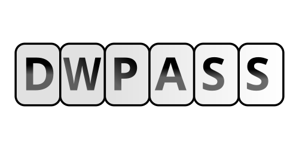

<br>

<p align="center">
  
</p>

<h1 align="center">
  dwpass-cli - A Diceware Passphrase Generator.
</h1> <br>

<p align="center">
  A Modern Cli Diceware Passphrase Generator. <br> Built with modern C++ for performance, simplicity, and reliability. <br><br>
</p>

<p align="center">
  
  
  
  
  
</p> <br>

<div align="center">

[Project Structure](#project-structure) ·
[Requirements](#requirements) ·
[Build](#build) ·
[Run Examples](#run-examples)

</div> <br>

A high-performance, security-focused command-line interface (CLI) tool for generating passphrases using the Diceware method. The project combines the convenience of terminal-based automation with the rigor of physical entropy and the operating system's cryptographic sources.

<br>

> [!TIP]
> dwpass-cli.

<br>

## Project Structure:

```text
dwpass-cli/                                                          
├── assets/                             # Dwpass-cli Assets File.
│   └── logo/                           # Dwpass-cli Logo File.
│
├── program/                            # dwpass-cli program File.
│   ├── include/                        # Program Include Directory.
│   │   └── cli/                        # Cli Include Directory.
│   │
│   └── src/                            # program src Directory.
│       └── cli/                        # Cli src Directory.
│           └── command_table/          # Program Command Table. 
│
├── CMakeLists.txt                      # Project Root CMakeLists.txt
├── LICENSE                             # Project License.
└── README.md                           # Technical Documentation.
```

<br>

## Requirements:

Before building dwpass, make sure the following dependencies are installed. <br>

###  Arch Linux:

```bash
sudo pacman -S --needed base-devel cmake gcc git
```

###  Debian:

```bash
sudo apt update

sudo apt install -y build-essential cmake gcc g++ git
```

###  Windows

Open **PowerShell as Administrator** and run:

```powershell
winget install Git.Git
winget install Kitware.CMake

winget install Microsoft.VisualStudio.2022.BuildTools --override "--add Microsoft.VisualStudio.Workload.VCTools --includeRecommended"
```

<br><br>

Packages installed:

- `base-devel` — Essential build tools (make, linker, etc.).
- `gcc` — C/C++ compiler with C++20 support.
- `cmake` — Build system generator.
- `git` — Repository cloning.

<br><br>

# Build

Requires a compiler with **C++** support **clang++/g++**.

```bash
git clone https://github.com/KauanSystems/dwpass-cli.git

cd dwpass-cli

cmake -B build

cmake --build build
```

<br><br>

# Run Examples:

Practical examples of commands for using the program via a command-line interface, regardless of the operating system the user is running. <br>

> [!TIP]
> The -e parameter applies to all the statements below.

<br>

To simply generate a Diceware passphrase.
```bash
dwpass-cli -g
``` 
<br>

To generate a Diceware file and export it.
```bash
dwpass-cli -g -e
```
<br>

To give yourself the input of a real datum to guarantee maximum entropy to your diceware passphrase.
```bash
dwpass-cli -i
```

To ensure maximum entropy and pass the desired number of phrases, pass the desired number of phrases.
```bash
dwpass-cli -i NUM_PHRASES_PASS
```

Provide the program with a standard wordlist file so that it can generate content based on your language
```bash
dwpass-cli -w FILE_PATH
```

<br><br><br><br><br>

<p align="center">
  
</p>

<h1 align="center">Dwpass-cli</h1> <br>

<p align="center">
  A Modern Cli Diceware Passphrase Generator. <br> Built with modern C++ for performance, simplicity, and reliability. <br><br>
</p>

<p align="center">
  
  
  
  
  
</p> <br>

<div align="center">

[Project Structure](#project-structure) ·
[Requirements](#requirements) ·
[Build](#build) ·
[Run Examples](#run-examples)

</div> <br><br>

<p align="center">
  Developed by KauanSysytems.
</p> <br>

<br><br><br><br><br>
